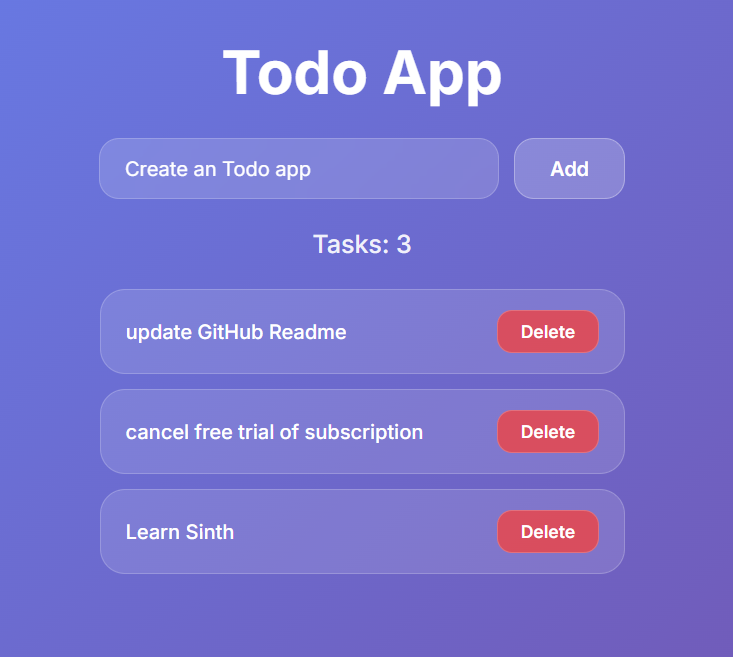

import 
{ 
  
  
  Code, 
  FileTree 
  
  
  }
from '@astrojs/starlight/components';

export const todoSinth = 
`
page

title = "Todo App"

var str newTodo = ""
var str[] todos = []
var str[] removedTodos = []

function addTodo() {
    if newTodo != "" {
        todos.push(newTodo)
        newTodo = ""
    }
}

function removeTodo(index) {
    var str[] newList = []
    for todo, i in todos {
        if i != index {
            newList.push(todo)
        }
    }
    todos = newList
}

style lang="scss"{
  @import url('https://fonts.googleapis.com/css2?family=Inter:wght@400;500;600;700&display=swap');
  
  * {
    font-family: 'Inter', sans-serif;
    margin: 0;
    padding: 0;
    box-sizing: border-box;
  }
  
  body {
    background: linear-gradient(135deg, #667eea 0%, #764ba2 100%);
    min-height: 100vh;
  }
  
  input {
    padding: 14px 20px;
    font-size: 16px;
    border-radius: 16px;
    border: 1px solid rgba(255,255,255,0.2);
    outline: none;
    width: 320px;
    background: rgba(255,255,255,0.15);
    color: #ffffff;
    backdrop-filter: blur(10px);
    transition: all 0.3s ease;
    
    &:focus {
      border-color: rgba(255,255,255,0.5);
      background: rgba(255,255,255,0.25);
      box-shadow: 0 0 20px rgba(255,255,255,0.1);
    }
    
    &::placeholder {
      color: rgba(255,255,255,0.6);
    }
  }
  
  button {
    cursor: pointer;
    transition: all 0.3s ease;
    
    &:hover {
      transform: translateY(-2px);
      box-shadow: 0 5px 20px rgba(0,0,0,0.2);
    }
    
    &:active {
      transform: translateY(0);
    }
  }
}

Main {
  Div(
    display: "flex",
    flexDirection: "column",
    alignItems: "center",
    padding: "60px 20px",
    gap: "24px"
  ) {
    Heading(level: 1, color: "#ffffff", fontSize: "48px", fontWeight: "700") {
      "Todo App"
    }
    
    Div(display: "flex", gap: "12px") {
      Input(
        bind: newTodo,
        placeholder: "What needs to be done?"
      )
      Button(
        onClick: addTodo(),
        padding: "14px 28px",
        fontSize: "16px",
        fontWeight: "600",
        borderRadius: "16px",
        border: "1px solid rgba(255,255,255,0.3)",
        backgroundColor: "rgba(255,255,255,0.2)",
        color: "#ffffff",
        backdropFilter: "blur(10px)"
      ) {
        "Add"
      }
    }
    
    Heading(level: 2, color: "rgba(255,255,255,0.9)", fontSize: "20px", fontWeight: "500") {
      "Tasks: " + todos.length
    }
    
    Div(
      display: "flex",
      flexDirection: "column",
      gap: "12px",
      width: "420px"
    ) {
      for todo, index in todos {
        Div(
          display: "flex",
          justifyContent: "space-between",
          alignItems: "center",
          padding: "16px 20px",
          backgroundColor: "rgba(255,255,255,0.12)",
          borderRadius: "20px",
          border: "1px solid rgba(255,255,255,0.2)",
          backdropFilter: "blur(10px)",
          transition: "all 0.3s ease"
        ) {
          Paragraph(
            color: "#ffffff",
            fontSize: "16px",
            fontWeight: "500"
          ) { todo }
          
          Button(
            onClick: removeTodo(index),
            padding: "8px 18px",
            fontSize: "14px",
            fontWeight: "600",
            borderRadius: "12px",
            border: "1px solid rgba(255,255,255,0.2)",
            backgroundColor: "rgba(239,68,68,0.8)",
            color: "#ffffff",
            backdropFilter: "blur(5px)"
          ) {
            "Delete"
          }
        }
      }
    }
  }
}
`;
export const fileName = 'todo.sinth';
export const highlights = ['file', 'CMS'];

## Minimum Required Structure
<FileTree>

- todo-app
  - todo.sinth

</FileTree>

## Code

  <Code code={todoSinth} lang="ts" title="todo.sinth" />

## Preview

Change the style as you like!